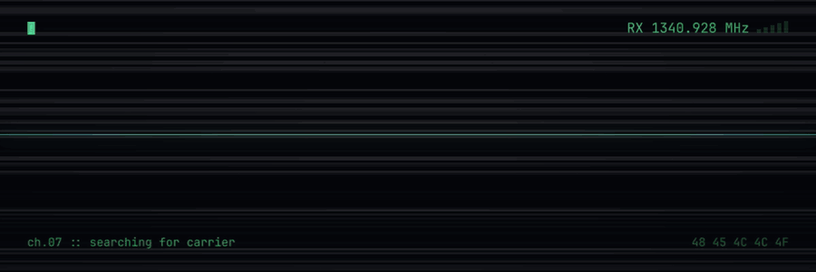

  

# Changelog

* 2026-11-09 - Information integrity is the mother of all battles: we win that, we win everything. We lose that, we lose everything. - [Maria A. Ressa](https://www.rappler.com/voices/newsletters/democracy-battle-journalism-tech-maria-ressa-2026/)
* 2026-10-06 - [Fyne](https://github.com/fyne-io/fyne) is fine, Linux mobile too - https://github.com/fyne-io/fyne/discussions/6575
* 2026-10-01 - Vibecoded territory - https://gist.github.com/rubiojr/611f8de038dd030aff9f6c521a8c55ac #ai

<!-- microblog:archives -->
Archives: [2026](archives/2026.md) · [2025](archives/2025.md)
<!-- /microblog:archives -->

<!-- microblog:tags -->
Tags: [#ai](tags/ai/) · [#civic-tech](tags/civic-tech/) · [#life](tags/life/) · [#linux](tags/linux/) · [#meshtastic](tags/meshtastic/) · [#privacy](tags/privacy/) · [#programming](tags/programming/) · [#qt](tags/qt/) · [#reading](tags/reading/) · [#risor](tags/risor/) · [#rugo](tags/rugo/) · [#sandboxing](tags/sandboxing/)
<!-- /microblog:tags -->
